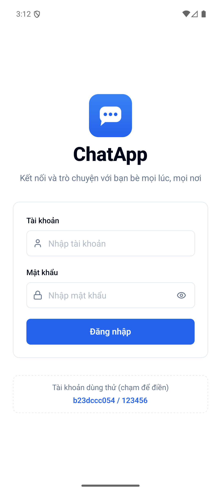
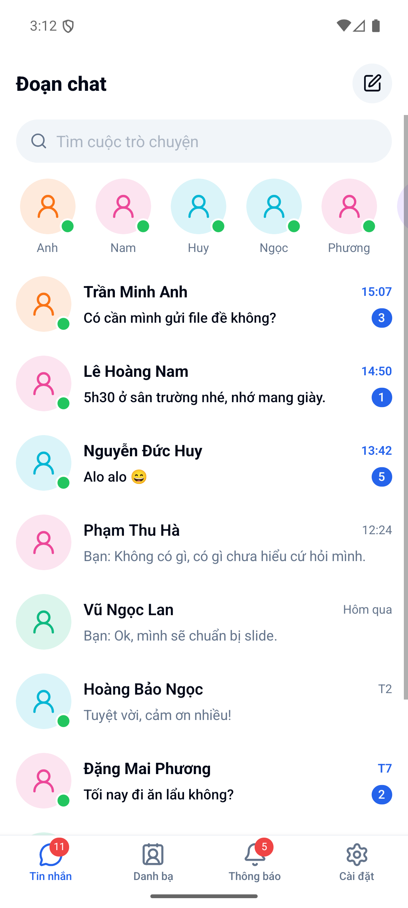
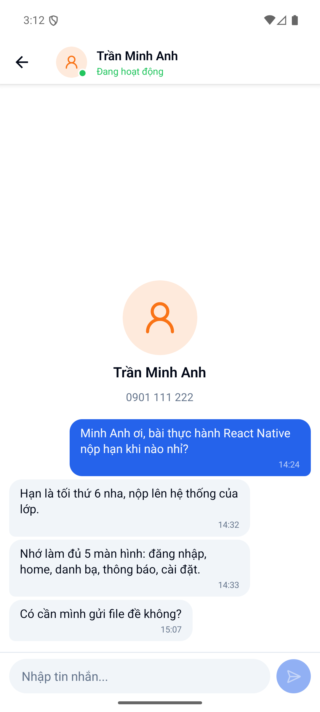
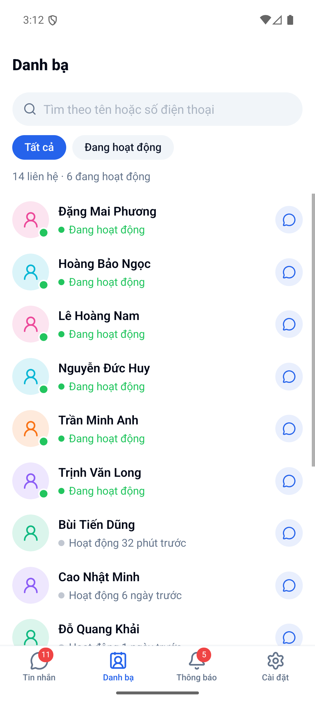
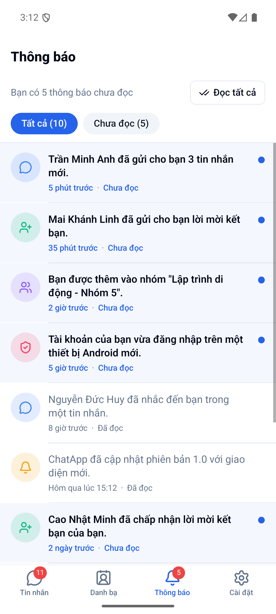
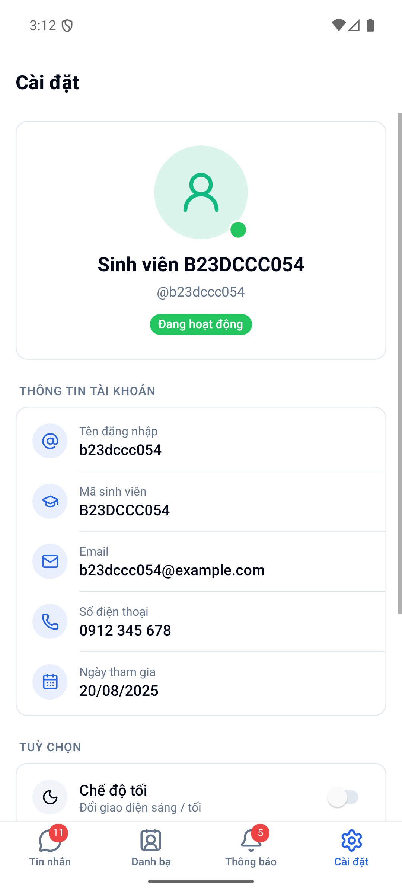

# ChatApp — B23DCCC054_APPDNT_TH02

Ứng dụng chat trên di động viết bằng **React Native CLI 0.87 (không dùng Expo)**, điều hướng bằng
**React Navigation 7**, giao diện dựng bằng **React Native Reusables** (shadcn/ui cho React Native,
chạy trên NativeWind 4 + Tailwind CSS 3). Dữ liệu là dữ liệu mẫu trong bộ nhớ, không có máy chủ.

## Tài khoản dùng thử

| Tài khoản    | Mật khẩu   |
| ------------ | ---------- |
| `b23dccc054` | `123456`   |
| `admin`      | `admin123` |

Ở màn Đăng nhập có thể chạm vào khung "Tài khoản dùng thử" để tự điền.

## Chạy ứng dụng (Android)

```sh
npm install
npm start                 # terminal 1: Metro
npm run android           # terminal 2: build + cài lên emulator/thiết bị
```

Yêu cầu: Node ≥ 22.11, JDK 17, Android SDK (đã cấu hình `ANDROID_HOME`), một emulator đang chạy
hoặc điện thoại bật USB debugging. Ảnh đại diện là icon người dùng (màu nền theo tên), không cần mạng.

Kiểm tra mã: `npx tsc --noEmit`, `npm run lint`, `npm test`.

## Các màn hình

| Màn hình                 | Chức năng                                                                                                                                                                                |
| ------------------------ | ---------------------------------------------------------------------------------------------------------------------------------------------------------------------------------------- |
| Đăng nhập                | Tên + logo ứng dụng, ô tài khoản/mật khẩu (ẩn/hiện mật khẩu), báo lỗi khi để trống hoặc sai tài khoản, đăng nhập thành công → Home                                                         |
| Home (Tin nhắn)          | Danh sách cuộc trò chuyện: ảnh đại diện, tên, tin gần nhất, thời gian, số tin chưa đọc; ô tìm kiếm (không dấu vẫn tìm được); dải người đang hoạt động; nút soạn tin mới → Danh bạ          |
| Chat                     | Nội dung cuộc trò chuyện, gửi tin nhắn, bạn chat tự trả lời sau ~2 giây (có trạng thái "đang soạn tin"), mở ra là tự đánh dấu đã đọc                                                       |
| Danh bạ                  | Danh sách người dùng: ảnh, tên, trạng thái trực tuyến; tìm theo tên/số điện thoại; lọc "Đang hoạt động"; chạm → mở (hoặc tạo) cuộc trò chuyện tương ứng                                   |
| Thông báo                | Nội dung, thời gian, trạng thái đã đọc/chưa đọc (nền, chấm xanh, chữ đậm khác nhau); chạm để đánh dấu đã đọc, nhấn giữ để đổi trạng thái, nút "Đọc tất cả", lọc "Chưa đọc"                 |
| Cài đặt                  | Thông tin tài khoản; `Switch` chế độ tối, hiện/ẩn huy hiệu chưa đọc trên tab, trạng thái hoạt động; nút Đăng xuất (hộp thoại xác nhận) → quay về Đăng nhập                               |

## Giao diện

<table>
  <tr>
    <td align="center"><br><b>Đăng nhập</b></td>
    <td align="center"><br><b>Home</b></td>
    <td align="center"><br><b>Chat</b></td>
  </tr>
  <tr>
    <td align="center"><br><b>Danh bạ</b></td>
    <td align="center"><br><b>Thông báo</b></td>
    <td align="center"><br><b>Cài đặt</b></td>
  </tr>
</table>

## Cấu trúc thư mục

```
App.tsx                     Providers + NavigationContainer + PortalHost
global.css                  Biến màu sáng/tối của RN Reusables (NativeWind)
tailwind.config.js          Theme Tailwind dùng biến CSS ở trên
components.json             Cấu hình CLI RN Reusables (alias @/components/ui)
src/
  navigation/               RootNavigator (native stack: Login | Main, Chat) và MainTabs (bottom tabs)
  screens/                  LoginScreen, HomeScreen, ChatScreen, ContactsScreen, NotificationsScreen, SettingsScreen
  components/ui/            Component sinh từ RN Reusables (button, input, card, avatar, badge, alert-dialog…)
  components/               Component riêng của app (UserAvatar, SearchBar, ConversationItem, …)
  store/                    Context + reducer: Auth, Chat, Notification, Preferences
  data/                     Dữ liệu mẫu: tài khoản, người dùng, cuộc trò chuyện, thông báo
  lib/                      auth (kiểm tra đăng nhập), format (thời gian, tìm kiếm tiếng Việt), theme, utils (cn)
__tests__/                  Unit test cho đăng nhập, định dạng và reducer
```

Đăng nhập/đăng xuất dùng mô hình "conditional screens" của React Navigation: khi `user` trong
`AuthContext` khác `null` thì stack chỉ có `Main` + `Chat`, ngược lại chỉ có `Login` — nên đăng nhập
xong tự vào Home, đăng xuất tự quay về Đăng nhập và không thể bấm Back quay lại.

## Ghi chú kỹ thuật

- `metro.config.js` ép mọi `@rn-primitives/*` về bản CommonJS. Nếu không, Metro nạp cả bản `.mjs`
  lẫn `.js` của `@rn-primitives/portal`, khi đó AlertDialog và `<PortalHost />` dùng hai store khác
  nhau và hộp thoại Đăng xuất không bao giờ hiện.
- `index.js` import `react-native-reanimated` ngay từ đầu. Metro bật `inlineRequires` nên Reanimated
  chỉ được khởi tạo khi lần đầu dùng tới, làm animation mở hộp thoại lần đầu bị lỡ (hộp thoại vô hình).
- Các component bắt buộc theo đề đều có trong code: `View`, `Text`, `TextInput` (ô nhập, ô chat),
  `Image` (logo màn Đăng nhập), `TouchableOpacity` (các dòng danh sách),
  `FlatList` (mọi danh sách), `Switch` (màn Cài đặt).

## Thêm component RN Reusables

```sh
npx @react-native-reusables/cli@latest add <tên-component> --styling-library nativewind
```
